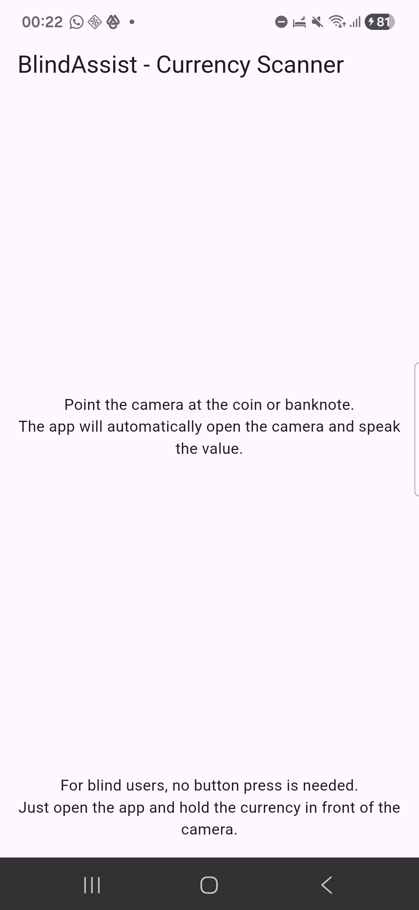

# Kafif Mobile



An offline Flutter app that helps blind and visually impaired people identify Moroccan coins and banknotes. The user points the phone at a coin or note, and the app announces the denomination out loud ("Twenty dirhams").

Kafif Mobile is half of **Kafif**, my capstone project at Al Akhawayn University (supervised by Dr. Yousra Chtouki). The other half is a Chrome extension for accessible web reading and multilingual summaries.

## Why

Moroccan currency has no consistent tactile markers, and there was no offline tool for identifying it. Blind users had to rely on other people to check their money, which costs them autonomy and privacy.

## How it works

1. The app opens the camera, loads the model and starts text-to-speech, then tells the user it is ready.
2. The user takes a photo of a coin or banknote.
3. The photo is centre-cropped to a square, resized to 224×224 and normalized to [−1, 1], matching training exactly.
4. A TensorFlow Lite model runs **on the device** and returns a probability for each class.
5. The top class is spoken in English, French or Arabic. If confidence is below 40%, the app says *"I am not sure about this currency, please try again."*

Everything runs locally. No images are uploaded or stored, and no internet connection is needed.

## Model

| | |
|---|---|
| Architecture | MobileNetV3-Small (ImageNet weights) + dropout 0.2 + softmax head |
| Training | Transfer learning: frozen base first, then full fine-tuning at a lower learning rate (Adam, lr 1e-3, 15 epochs) |
| Augmentation | Random flip, rotation, zoom |
| Classes | 11 Moroccan coin and banknote classes |
| Dataset | Built from scratch: photos taken by hand with a smartphone under different lighting, backgrounds, distances and angles (no public dataset exists) |
| Splits | Train / validation / held-out test |
| **Test accuracy** | **≈ 80%** |
| Deployment | Converted to TensorFlow Lite and run with `tflite_flutter` |

## Known limitations

- Glare on metal coins, strong shadows and very low light reduce accuracy.
- The dataset is small and some denominations (mostly coins) have fewer images.
- Most photos were taken with a single phone, so results may vary on weaker cameras.
- Testing with visually impaired users has been limited so far.

## Next steps

- Grow the dataset with more lighting conditions, angles and phone models.
- Real-time scanning without having to take a photo.
- Adding up amounts (20 + 50 = 70 MAD) and support for other currencies.

## Tech stack

Flutter (Dart 3) · `tflite_flutter` · `camera` / `image_picker` · `image` · `flutter_tts` · TensorFlow 2 / Keras (Google Colab)

## Run it

```bash
git clone https://github.com/oussamahamdaoui220-104003/Kafif-Mobile.git
cd Kafif-Mobile
flutter pub get
flutter run        # with an Android device connected
```

The `.tflite` model and `class_names.json` are bundled in `assets/`.

## Author

Oussama Hamdaoui · MSc Data Science & AI, Université Côte d'Azur
